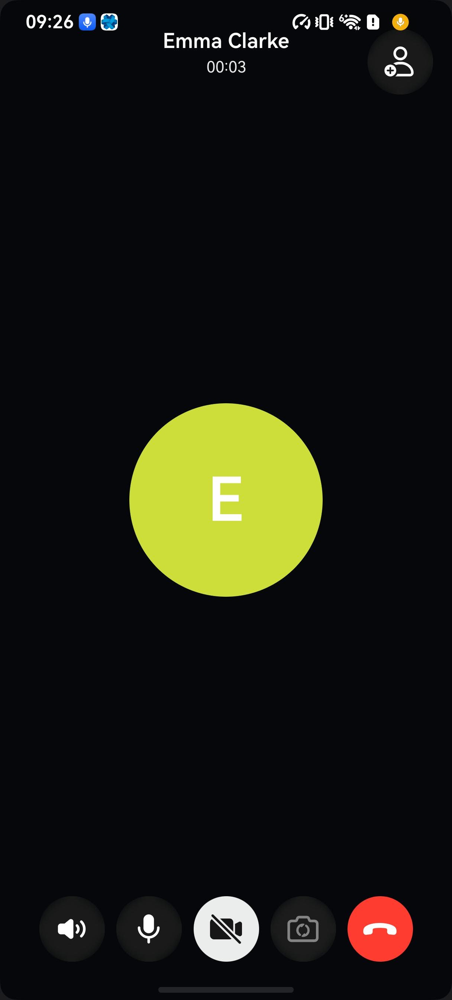
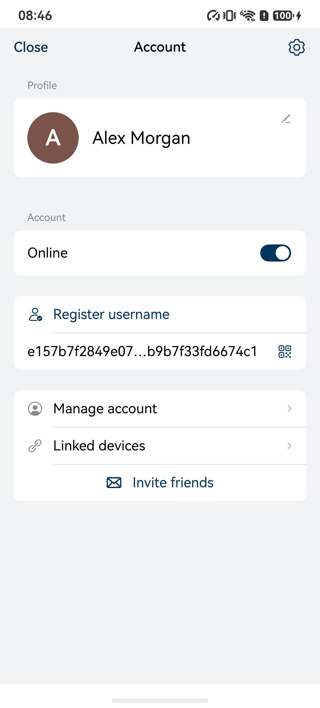

<p align="center"></p>
<h2 align="center"><b>Jami</b></h2>
<h4 align="center">Free, private, peer-to-peer messaging and calls, rebuilt natively for HarmonyOS NEXT.</h4>

<p align="center"></p>

> ### Please read this first
>
> This is an unofficial port. It is not affiliated with, endorsed by, or supported by Savoir-faire
> Linux or the Jami project. If something here is broken, it is broken here. Do not open an issue
> upstream for it.
>
> The name Jami and the Jami logo belong to Savoir-faire Linux. The GPL covers the source code, not
> the name and not the artwork. Both are used here only to say what this is a port of, and both will
> change if the upstream authors would rather we did not use them.

<p align="center"><a href="#screenshots">Screenshots</a> &bull; <a href="#install">Install</a> &bull; <a href="#known-limits">Known limits</a> &bull; <a href="#known-issues">Known issues</a> &bull; <a href="#function-list-comparison">Function list comparison</a> &bull; <a href="#license">License</a></p>

<hr>

Jami is a free and open-source communication app by Savoir-faire Linux. There is no central server
holding your account or your messages: an account is a key pair on your device, conversations are
Git-backed "swarms" synchronised directly between the participants' devices, and peers find each
other over a distributed hash table (OpenDHT). It does text and file messaging, audio and video
calls, group calls, collaborative documents, and SIP accounts next to Jami accounts.

This repository is the Jami iOS client rewritten for HarmonyOS NEXT in ArkTS, against ArkUI. The
engine is not rewritten: `libjami`, the same C++ daemon every Jami client runs, is cross-compiled
for `aarch64-linux-ohos` together with its dependencies (OpenDHT, dhtnet, PJSIP, FFmpeg, GnuTLS,
libgit2 and the rest, under `third_party/jami-ohos`) and reached from ArkTS through one N-API module,
`entry/src/main/cpp/napi_jami.cpp`. The ArkTS side follows the iOS client's structure: its services,
view models and screens keep their Swift names, so a reader can put the two side by side.

Upstream lives at [git.jami.net](https://git.jami.net/savoirfairelinux). This port is based on
**Jami for iOS 4.20**, which is also the reference build every test case here was driven against -
first on an iPhone, then replayed on the HarmonyOS phone. The last round of fixes follows **4.21**, the
version the App Store now ships (the new media preview, and how a removed group member is announced). If you are on iOS or Android, use the
official app instead. This port exists for people whose phone runs HarmonyOS NEXT.

## Screenshots

<!-- Captured on the port device, Huawei BRA-AL00 / HarmonyOS 6.1 (API 24). Conversations, chat, call, group with a collaborative document, account. -->
<p align="center">





</p>

## Install

There is no prebuilt package here. You build it and sign it yourself, which also means the package
carries your certificate and your device list rather than someone else's.

You need DevEco Studio 6.x with the HarmonyOS SDK (API 24), a Huawei developer account, and a device
running HarmonyOS NEXT 6.1 or newer.

1. Clone this repository and open the folder in DevEco Studio. The prebuilt native libraries in
   `third_party/jami-ohos` are part of the repository; the native module (`napi_jami.cpp`) is
   compiled by the normal build.
2. Go to **File > Project Structure > Signing Configs**. Sign in, connect the device, and let
   DevEco generate a signature. The bundle name is `com.example.jami28092026`.
3. Build it from the project root with the hvigor inside DevEco Studio (macOS paths shown):

```bash
D=/Applications/DevEco-Studio.app/Contents
export JAVA_HOME=$D/jbr/Contents/Home DEVECO_SDK_HOME=$D/sdk
"$D/tools/node/bin/node" "$D/tools/hvigor/bin/hvigorw.js" \
  --mode module -p product=default assembleHap --no-daemon
```

4. Install and launch it. The package lands in `entry/build/default/outputs/default/`:

```bash
hdc install -r entry/build/default/outputs/default/entry-default-signed.hap
hdc shell aa start -a EntryAbility -b com.example.jami28092026
```

Update with `hdc install -r`. **Uninstalling deletes the app's data, and with it every Jami account
on the phone that has no backup** - there is no server copy to restore from. Back up an account
first (Account > Manage account > Backup) if you need to reinstall.

A generated debug signature only installs on the devices registered to it, and it expires. When it
does, open the same dialog and generate it again.

## Known limits

Things this port does differently because of something HarmonyOS does not give an app. The missing
capability is named so you can check it yourself.

| Limit | Missing HarmonyOS capability |
|---|---|
| **Calls and messages arrive only while Jami is open** | background delivery for an app that has no Huawei push sender. HarmonyOS freezes an app about 2 s after it leaves the screen (hilog: `Freeze pid ... success`, `hasBackgroundTask: 0`). A continuous task does not keep it reachable: the `VOIP` mode of `backgroundTaskManager.startBackgroundRunning` is cancelled by the system 60 s after the last call audio (`is not running voip`, cancel reason 2) and the app is frozen 6 s later; the other modes are checked against real work (audio playback, data transfer, location...), and `TASK_KEEPING` is limited to particular devices. HarmonyOS wakes a frozen app only through Push Kit (`pushService.getToken`, `RemoteNotificationExtensionAbility`, `VoIPExtensionAbility`), which needs the app registered in AppGallery Connect and a server that sends to Huawei's push service with the app's credentials. Jami's DHT proxy, which sends the pushes that wake the iOS and Android apps, can push only to Android, iOS and UnifiedPush endpoints (`PushType` in `opendht/dht_proxy_server.h`). Calls ring and messages arrive while Jami is on screen and during a call; messages sent while it was in the background are fetched when it is opened again |

Three platform gaps no longer show, because the app works around them: the system camera's review
screen (X / ✓) cannot be relabelled, so **Send photo** uses Jami's own capture screen with
*Retake* and *Use Photo*; `requestPermissionsFromUser` never asks again after a denial, so the camera
screens re-ask through `requestPermissionOnSetting`; and a web view's keyboard is not closed by
system Back, so the document editor handles Back itself.
## Function List Comparison

| Module | Rows | Both | iOS | HarmonyOS |
|---|---:|---:|---:|---:|
| Onboarding | 53 | 53 (100%) | 0 | – |
| Home | 72 | 72 (100%) | 0 | – |
| Chat | 90 | 90 (100%) | 0 | – |
| Calls | 34 | 33 (97%) | 1 | – |
| Account | 58 | 58 (100%) | 0 | – |
| Settings | 67 | 67 (100%) | 0 | – |
| Conversation Info | 56 | 56 (100%) | 0 | – |
| Documents | 54 | 54 (100%) | 0 | – |
| **Total** | **484** | **483 (99%)** | **1** | **–** |

The full table, one row per function with a note wherever the two apps differ, is in [docs/FUNCTION_LIST_COMPARISON.md](docs/FUNCTION_LIST_COMPARISON.md), and as a workbook with the same grouping as the Function List in [docs/FUNCTION_LIST_COMPARISON.xlsx](docs/FUNCTION_LIST_COMPARISON.xlsx).

## License

GPLv3, the same as upstream. The Jami iOS client it was ported from carries:

```
Copyright (C) 2017-2026 Savoir-faire Linux Inc.
```

Everything written for HarmonyOS is released under those same terms: you can use, study, share and
improve it at will. The native libraries under `third_party/jami-ohos` (libjami and the contrib
libraries it is built with) are binaries built from their upstream sources and keep their upstream
licenses; libjami itself is GPLv3.

More about Jami: [jami.net](https://jami.net/)
